# Part 9: Group Policy and Account Lockout

## Dilemma: BehelitTech has users and PCs, but no company wide rules. Someone could guess a password thousands of times and nothing would stop them, and changing settings on every PC by hand doesn't scale.
## Objective: Use Group Policy to set rules for the whole domain from one place, starting with an account lockout policy, then handle the lockout tickets it creates.

Steps

1) First we open Tools > Group Policy Management on DC01. This is where every policy for the domain lives.

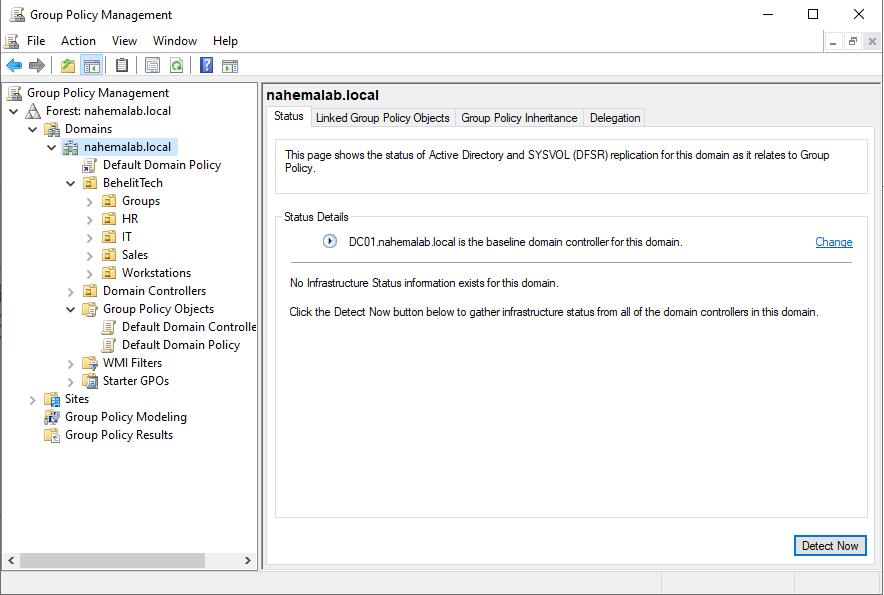

** A policy only does something once it's linked to a spot in this tree. Link it to the domain and it hits everyone. Link it to HR and only HR gets it. That's why we built OUs earlier.

2) Password and lockout rules for domain accounts only work at the domain level, so we edit the Default Domain Policy, which is linked to all of nahemalab.local.

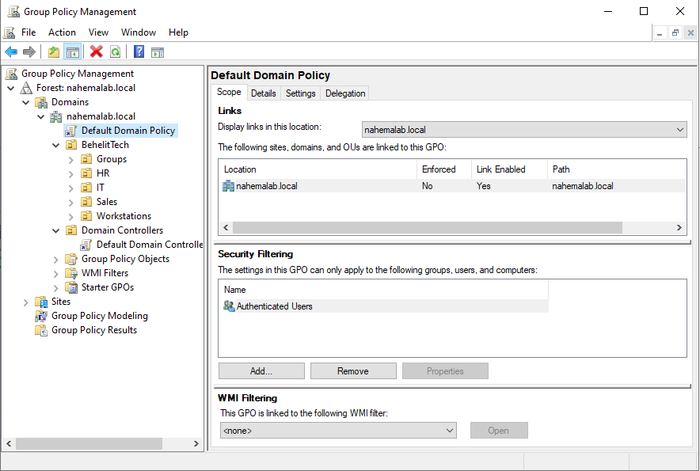

3) Before changing anything, I checked the existing Password Policy. This finally explained why the domain rejected my simple passwords back when I created users.

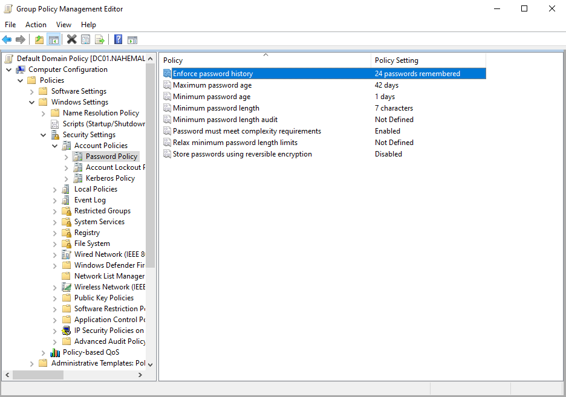

** Max password age is 42 days by default. Current guidance like NIST actually advises against forced regular changes, since people just go from Summer2026! to Fall2026!. Longer passwords and changing them only after a compromise work better.

4) Next we open Account Lockout Policy. By default, there is no lockout at all, so an attacker could guess passwords forever.

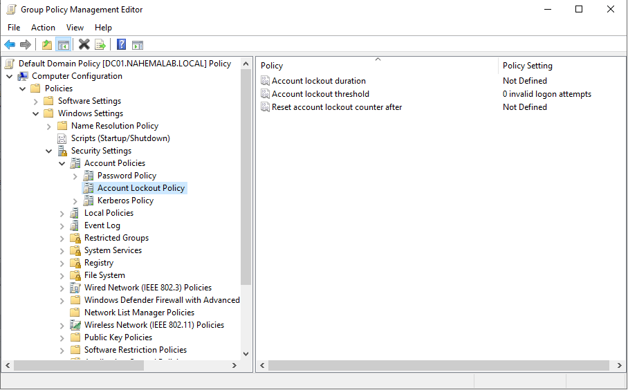

5) I set the threshold to 5 invalid attempts, with a 15 minute lockout and a 15 minute counter reset. 5 gives real people room for typos while stopping brute force guessing.

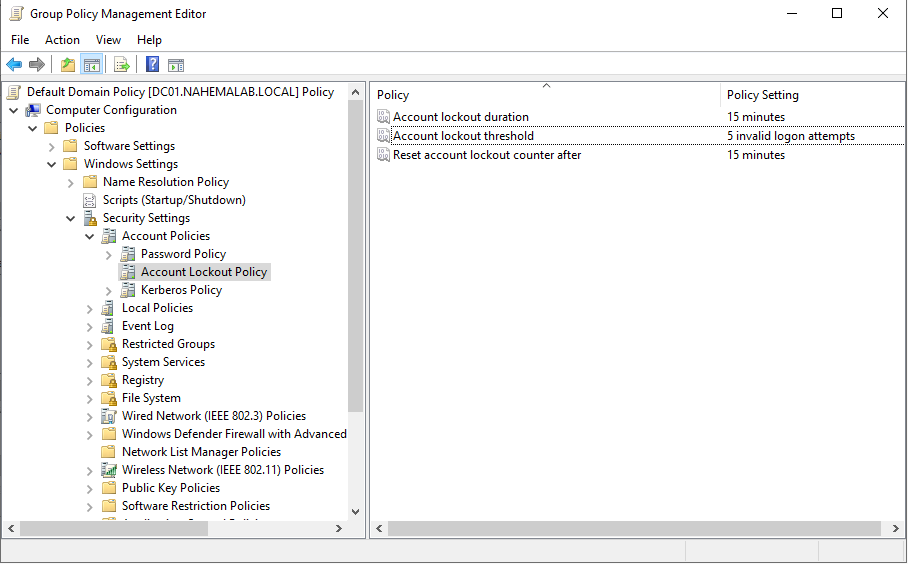

6) To apply it right away instead of waiting about 90 minutes, I ran this on DC01:
   terminal> gpupdate /force

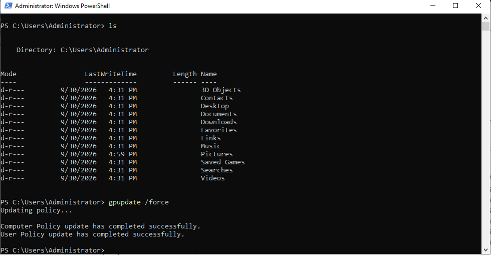

7) Great, now we test it. On CLIENT01 I typed a wrong password for Light Yagami 5 times, and Windows locked him out.

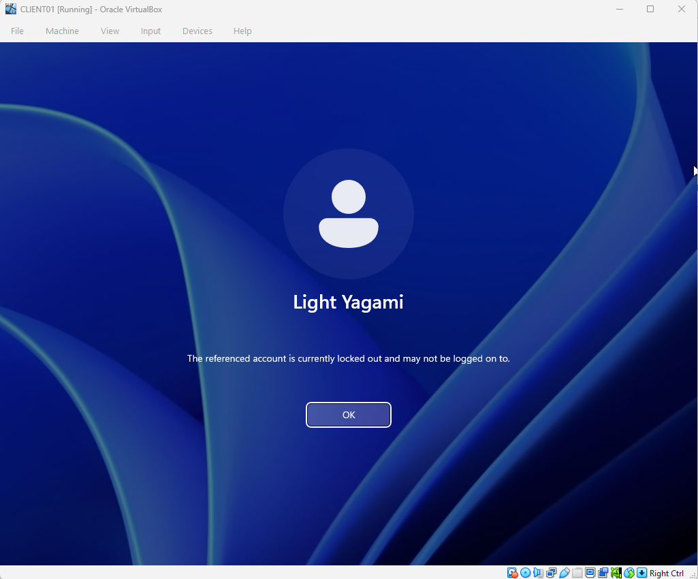

8) DC01 confirms it too. Light's Account tab in Active Directory now says the account is locked out.

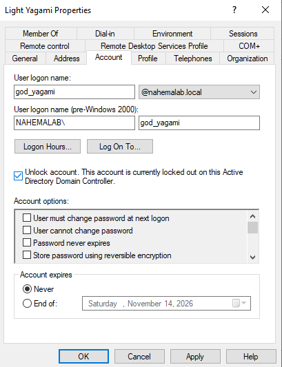

# Ticket #4: Locked Out of My Account

## Dilemma: The new policy works, which means people will now get locked out. Light called saying his account is locked but he's sure he knows his password.
## Objective: Confirm the lockout, make sure it's not an attack, and unlock him without resetting his password.

P3-medium / tier-1 / access

1) Same as any account ticket, I verified Light's identity by calling back the number on file first.

** A lockout isn't a forgotten password. Light knows his password, so the right fix is an unlock, not a reset. Resetting when you don't need to just creates a temp password floating around for no reason.

2) To investigate, I needed to see if Light was locked out, how many wrong passwords were typed, and when. Microsoft's documentation for Get-ADUser (Microsoft Learn) shows these are stored as properties on the account:
   terminal> Get-ADUser god_yagami -Properties LockedOut, BadLogonCount, LastBadPasswordAttempt | Select-Object Name, LockedOut, BadLogonCount, LastBadPasswordAttempt

** Tip: if you don't know what a property is called, run Get-ADUser <username> -Properties * to see everything AD stores about that user.

** That command works, but it's way too long to type every time. Light won't be the only person who gets locked out, and lockouts are one of the most common help desk tickets. So I turned it into a small reusable script.

3) I wrote Check-Lockout.ps1 in PowerShell ISE and saved it in C:\Scripts (also in this repo's [scripts folder](../scripts/Check-Lockout.ps1)):

   param($user)
   Get-ADUser $user -Properties LockedOut, BadLogonCount, LastBadPasswordAttempt |
       Select-Object Name, LockedOut, BadLogonCount, LastBadPasswordAttempt

   Now any lockout check is one short line:
   terminal> .\Check-Lockout.ps1 god_yagami

** param($user) is what lets the script take a username, like a function argument in Python. Same script, any employee.

4) My first run failed with "the term is not recognized." I was still in C:\Users\Administrator, not C:\Scripts. PowerShell only runs scripts from the folder you're in (or a full path).

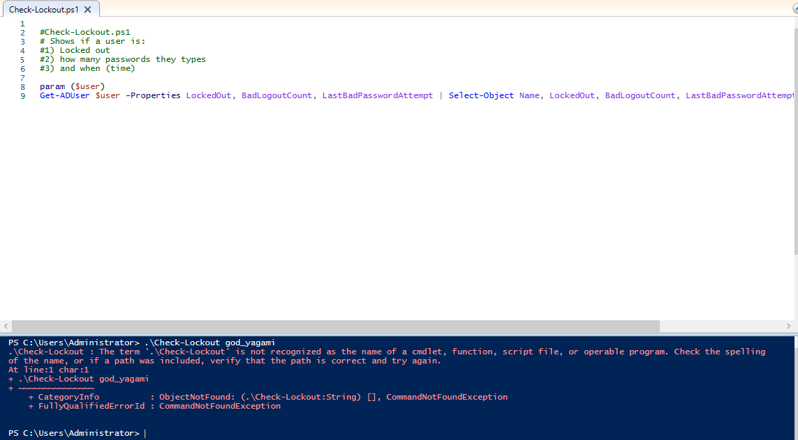

5) After moving into C:\Scripts and fixing a typo (BadLogoutCount instead of BadLogonCount, which made that column come out empty), the script worked. Interesting part: it showed LockedOut False with 5 bad attempts at 1:25 PM. The 15 minute lockout duration had already passed, so AD unlocked him on its own. The policy was doing exactly what I set it to.

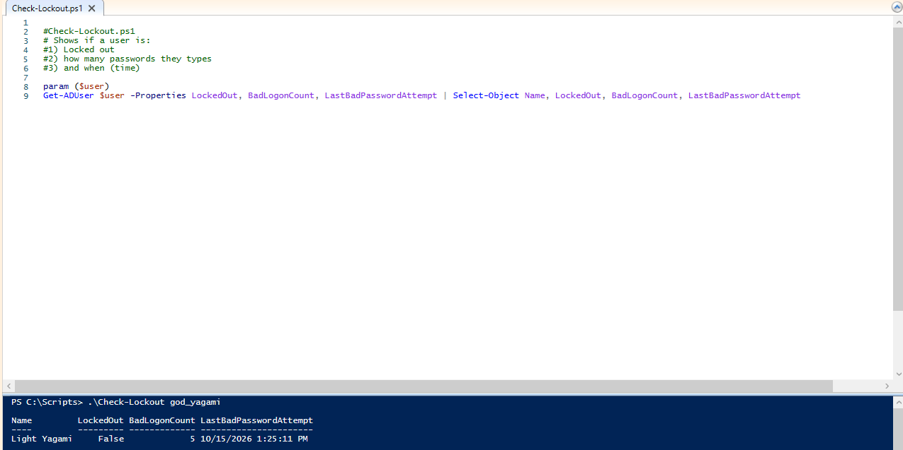

6) To work the full ticket, I locked Light out again and checked right away. Locked out, 5 bad attempts, and the timing matched his own attempts, so no sign of someone else guessing.

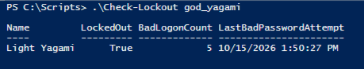

** Why check the timing? If he says "I tried twice this morning" but it shows 50 attempts at 3am, that's not a typo. That's someone trying to guess his password, and the ticket becomes a security issue.

7) Then we unlock him without touching his password:
   terminal> Unlock-ADAccount god_yagami
   Running the script again shows LockedOut False and the bad logon count back at 0.

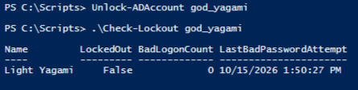

8) Light signed in on CLIENT01 with his normal password.

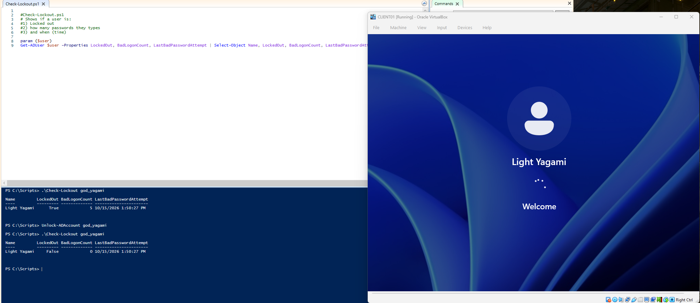

Root cause: user mistyped his password 5 times, triggering the new lockout policy. Policy working as intended.

# Part 10: Mapped Drives

## Dilemma: Every department has a shared folder, but to reach it people have to type the exact server address like \\DC01\HR every time. One typo and they're calling IT.
## Objective: Use Group Policy to give each department its own drive letter automatically at login, and only for the people in that department.

Steps

1) Here's the "before." Jon has to type \\DC01\HR by hand to reach the HR folder.

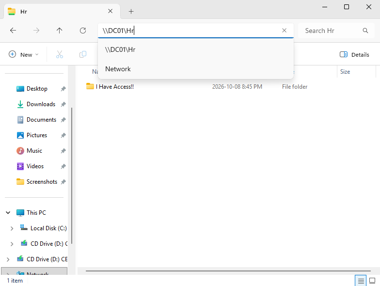

2) This time, instead of editing the default policy, we create our own. Right click the HR OU > Create a GPO in this domain, and Link it here, named HR - Mapped Drive. Linking it to the HR OU means only HR accounts get it.

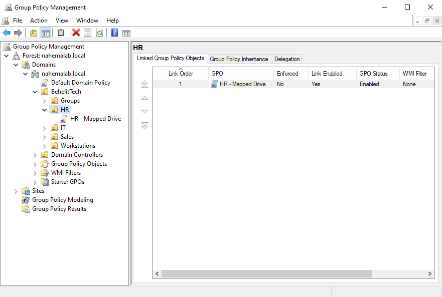

** I named it by who and what (HR - Mapped Drive) so anyone looking at the list can tell what it does without opening it.

3) Inside the policy, under User Configuration > Preferences > Windows Settings > Drive Maps, we add a new mapped drive: \\DC01\HR as H:, labelled HR Drive, with the action set to Update so it creates the drive if it's missing and fixes it if someone removes it.

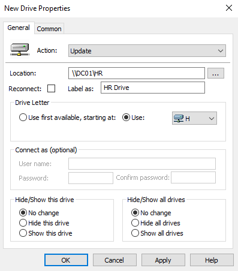

** It goes under User Configuration because the drive should follow the person. If Jon logs into any company PC, he gets H:.

4) Then we do the same for the other two departments: IT - Mapped Drive (\\DC01\IT as I:) and Sales - Mapped Drive (\\DC01\Sales as S:), each linked to its own OU.

5) Great, now we test it. On CLIENT01 as an HR user, after gpupdate /force and a fresh login, HR Drive (H:) shows up under This PC on its own.

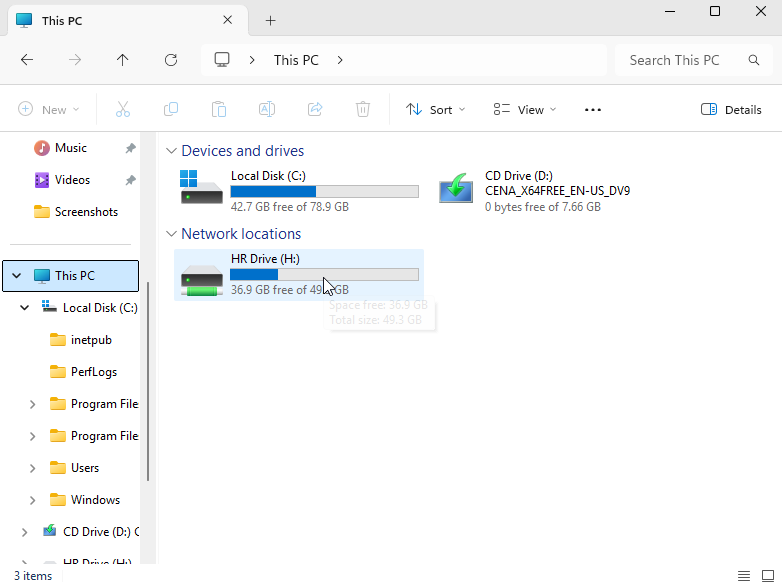

6) To prove WHY it showed up, gpresult /r lists which policies applied. The user sits in OU=HR and HR - Mapped Drive is applied.
   terminal> gpresult /r

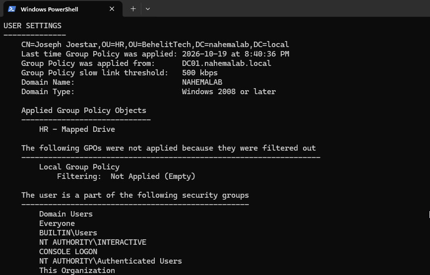

** gpresult is the real help desk skill here. Setting up a policy is easy. Being able to show why it did or didn't apply to someone is what tickets are about.

7) Each department gets only its own drive. Walter in IT gets IT - Mapped Drive, Don Draper in Sales gets Sales - Mapped Drive.

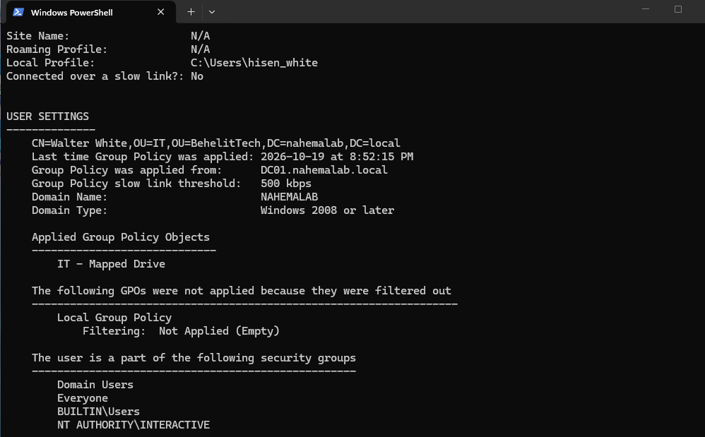
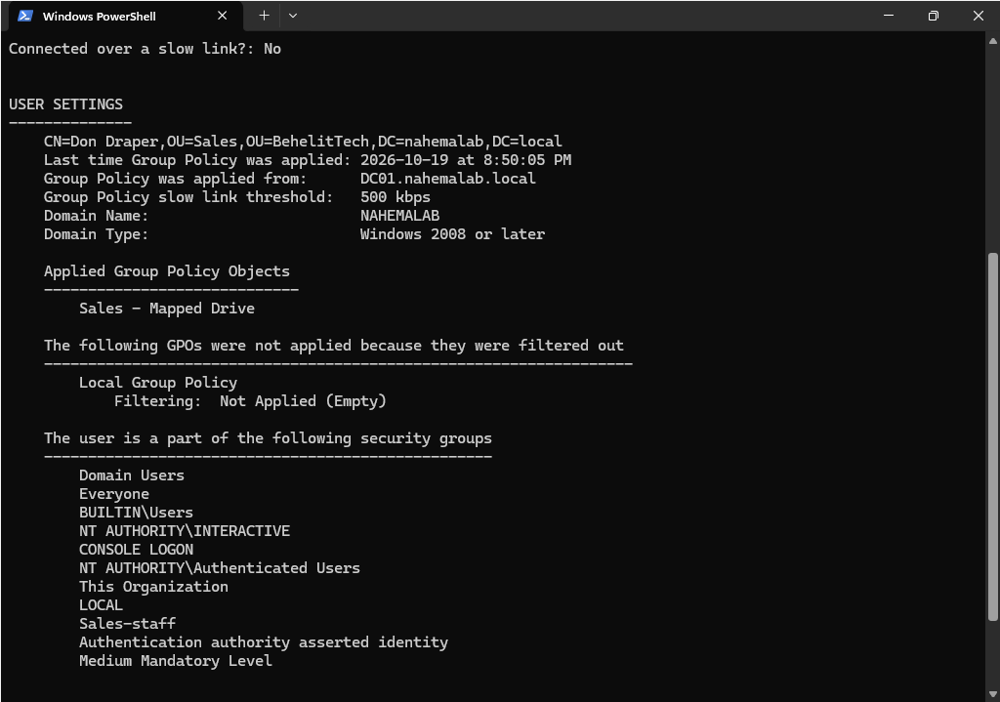

** Before the IT policy existed, Guts showed "N/A" for applied policies. That's normal, not broken. The Default Domain Policy only has computer settings (password and lockout rules), so it shows up under COMPUTER SETTINGS, not under the user.

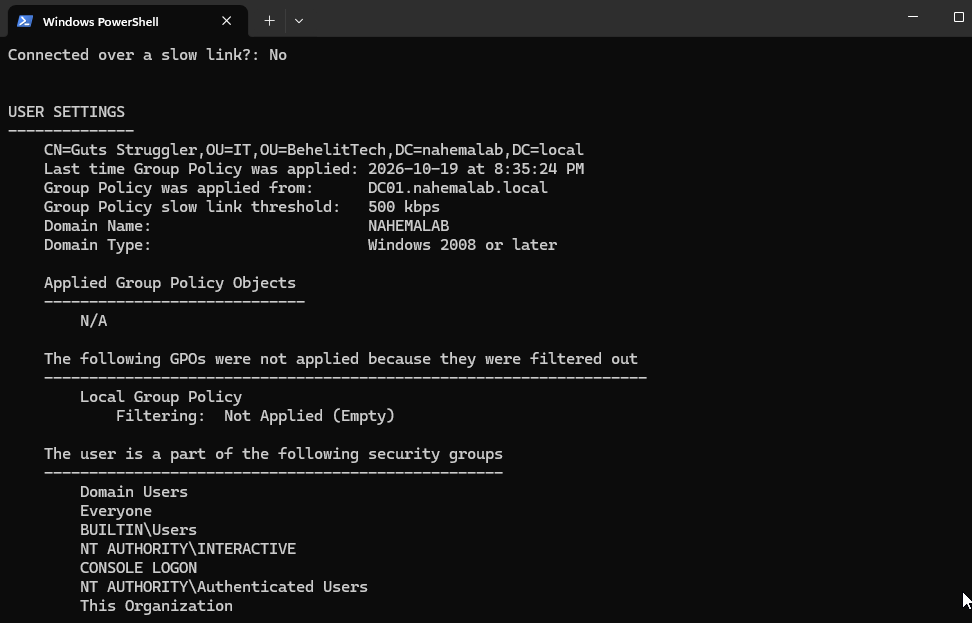

# Ticket #5: Sales Drive Showing for HR User (Simulated Setup Mistake)

## Dilemma: Mapped drives work for every department, but in a real company people get onboarded, moved and reorganized all the time, and mistakes happen. I wanted to practice what happens when someone ends up in the wrong place.
## Objective: Recreate a common onboarding mistake on purpose, then troubleshoot it like a real ticket using gpresult.

P3-medium / tier-1 / access

** To set this up, I moved Joseph Joestar from the HR OU into the Sales OU, as if someone picked the wrong department while setting up his account. The policies themselves weren't touched. From here on I worked it like a normal ticket from the user.

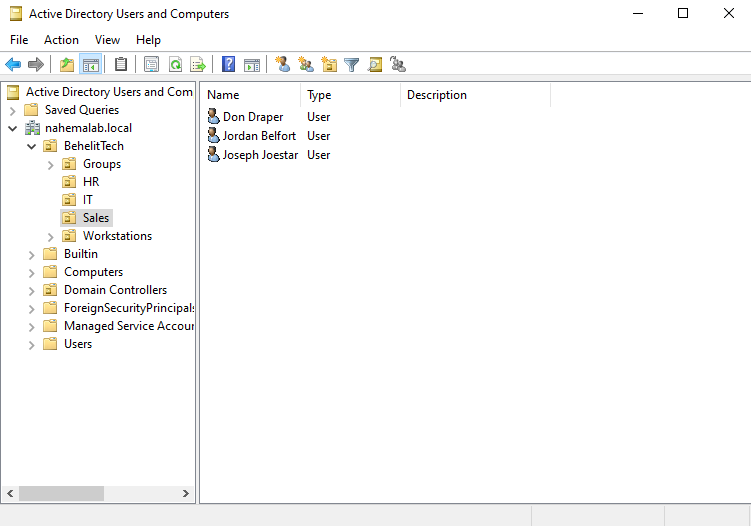

1) Joseph walked up saying "my H drive is gone and there's some Sales drive I've never seen." When I reproduced it, H: was actually still there and still opened. S: had also appeared, but gave access denied.

2) gpresult /r gave the answer right away. His account sat in OU=Sales, so the Sales mapped drive policy applied. But he was still in the HR-staff security group.

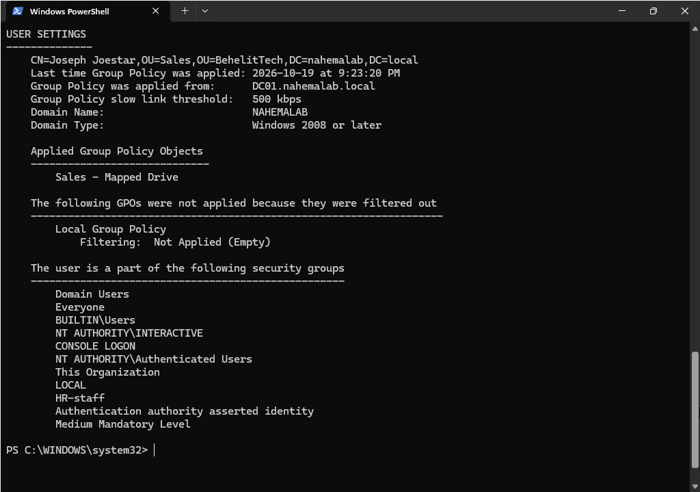

** This was the biggest lesson of the day: OUs decide which policies you get (which drives show up). Groups decide what you can open. Moving Joseph only changed his OU, so he got the Sales drive but couldn't open it, and kept access to HR because his group never changed. A drive showing up doesn't mean you have access to it.

3) The user said his H: drive was missing, but that turned out not to be the real problem. I kept his original words in the ticket and retitled it to the actual cause. Real tickets often start with the user describing a symptom, not the problem.

4) Before fixing anything, I turned on "Remove this item when it is no longer applied" (Common tab) on all three drive maps, so drives clean themselves up when someone changes departments.

5) Then the fix: move Joseph back to the HR OU, run gpupdate /force and sign in fresh.

6) But S: was still there. net use confirmed it was really still mapped, not just a leftover icon:
   terminal> net use
   terminal> net use S: /delete

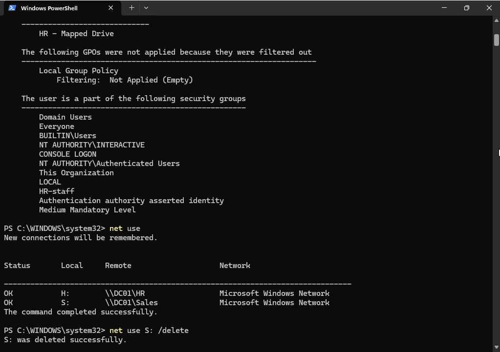

** Why didn't the remove setting work? It only removes a drive if the PC received the policy WITH that setting while it still applied. I ticked the box and moved Joseph back before CLIENT01 ever got the updated Sales policy, so his PC had no "remove me" instruction. The setting protects future moves, but anything mapped before it existed needs one manual cleanup.

Root cause: account placed in the wrong OU during setup. Prevention: drive maps now remove themselves when a user leaves a department.

# Part 11: Security Lockdown and Screen Lock

## Dilemma: Every employee can open Control Panel and Settings, where they can change network settings, uninstall apps or mess with security options. And any PC left unattended stays unlocked for anyone to use.
## Objective: Lock down settings for regular staff (HR and Sales) while IT keeps full access, and make every company PC lock itself when idle.

Steps

1) This time I created the policy in the Group Policy Objects folder first instead of on an OU, because one policy is going to be linked to two departments. Named it Staff - Restrictions.

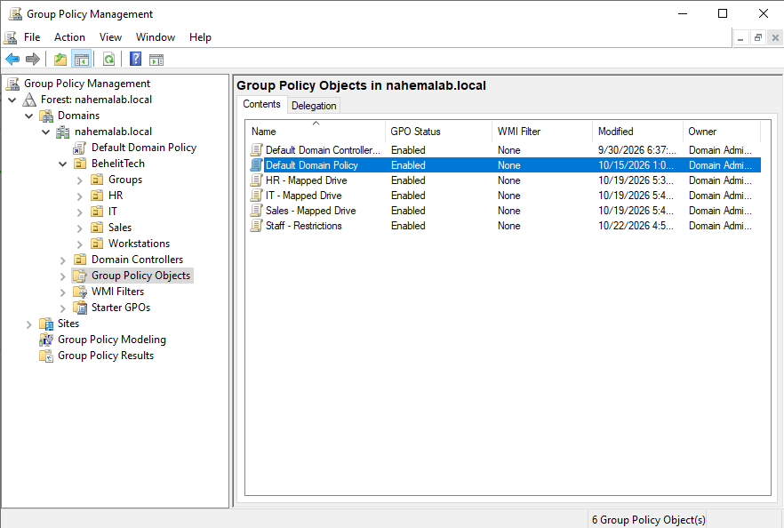

2) Inside it, under User Configuration > Policies > Administrative Templates > Control Panel, I enabled "Prohibit access to Control Panel and PC settings."

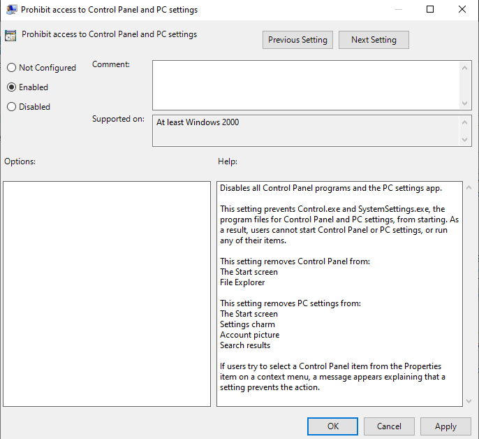

** Policies vs Preferences: the mapped drives were Preferences, which set things up but users can change them. Policies are enforced and can't be undone by the user, which is what security rules need.

** I also looked through the Network Connections restrictions, but didn't turn them on. Most are already blocked because staff aren't local admins, and some would break VPN for remote workers. Every restriction should solve a real problem, otherwise it just creates tickets.

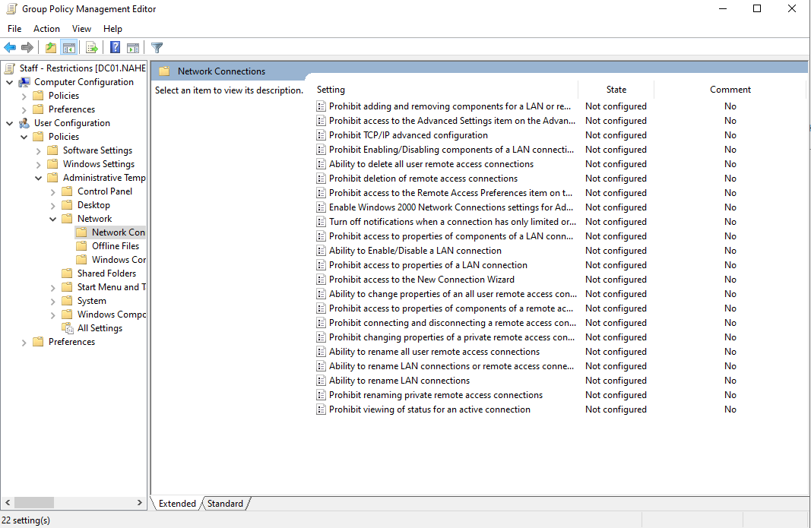

3) Then we link the same policy to both HR and Sales with Link an Existing GPO. One policy, two places, so any future change only happens once.

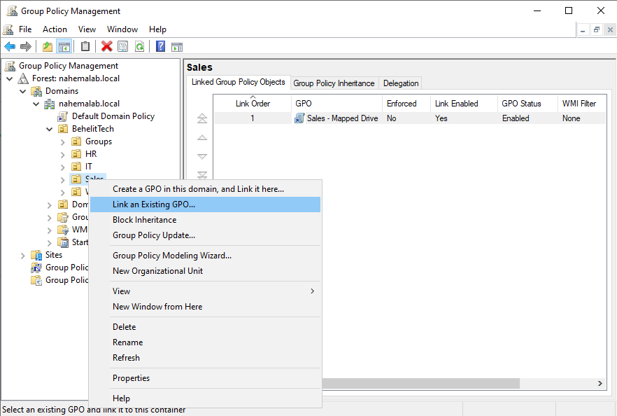

4) Great, now we test. Don Draper in Sales gets blocked trying to open Control Panel, and gpresult shows Staff - Restrictions applied alongside his Sales drive.

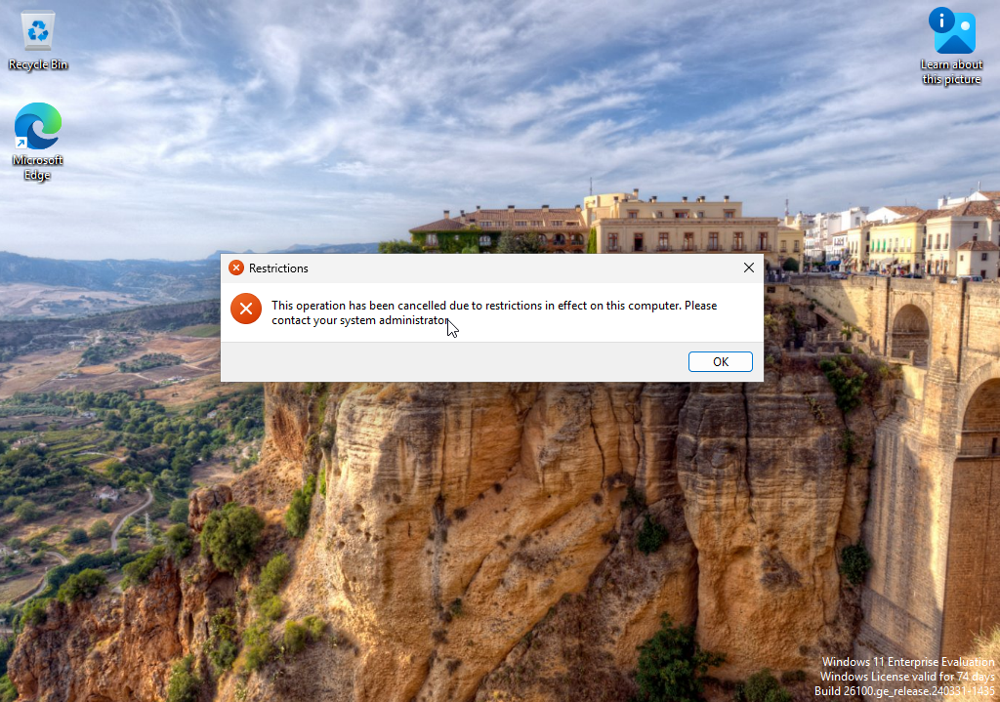
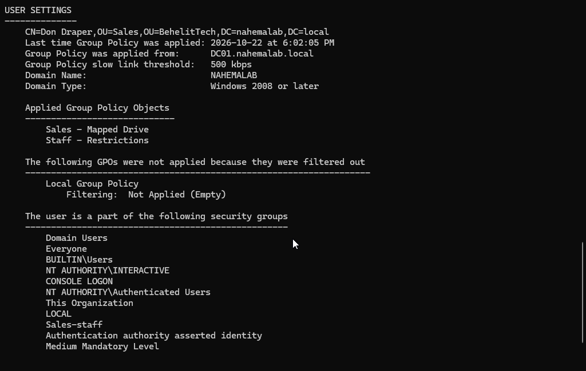

Guts in IT can still open Control Panel, since the policy isn't linked to the IT OU.

5) Next is the screen lock. This one is a computer policy, linked to the Workstations OU, so it locks the PC no matter who's logged in, even IT. Under Computer Configuration > Security Options, I set "Interactive logon: Machine inactivity limit." I tested with 60 seconds so I wouldn't have to wait, then set the real value of 600 (10 minutes). This setting needs a restart to kick in.

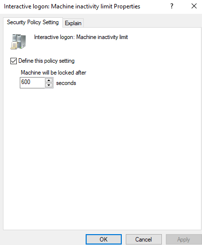

6) Checking computer policies with gpresult /r /scope computer gave me access denied as a regular user. Instead of logging the user out, I opened Command Prompt with Run as administrator using my separate admin account, which is exactly what the two account setup is for.
   terminal> gpresult /r /scope computer

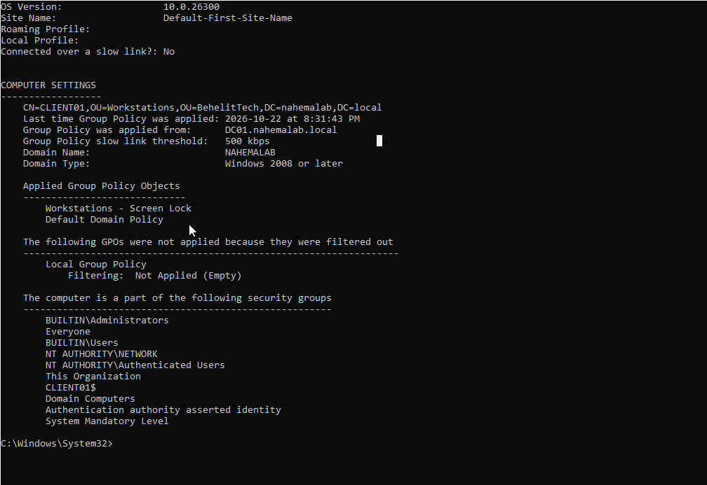

** User policies follow the person and show under USER SETTINGS. Computer policies stay with the PC and show under COMPUTER SETTINGS. When a setting "isn't working," checking the right half of gpresult is step one.

# Ticket #6: Sales Can Open Control Panel Again (Blind Troubleshooting)

## Dilemma: My earlier tickets felt too easy because I broke things myself and already knew the answer. Real tickets don't come with the cause attached.
## Objective: Troubleshoot a "policy not applying" ticket without knowing what changed, using evidence instead of guesses.

P3-medium / tier-1 / access

** How I set this up: I ran a [setup script](../scripts/Setup-Ticket6.ps1) that quietly made changes to Group Policy, without reading what it did. The scenario was designed with an AI assistant as a practice exercise. The commands come from Microsoft's GroupPolicy module (Set-GPLink and Set-GPPermission on Microsoft Learn). The troubleshooting below was all done blind.

** The script itself fought me first. It kept saying "Staff - Restrictions" didn't exist, even though Get-GPO -All listed it. The name had a character that looked identical but wasn't, so I had PowerShell look it up with a wildcard instead of typing it. Scripts are picky about exact names.

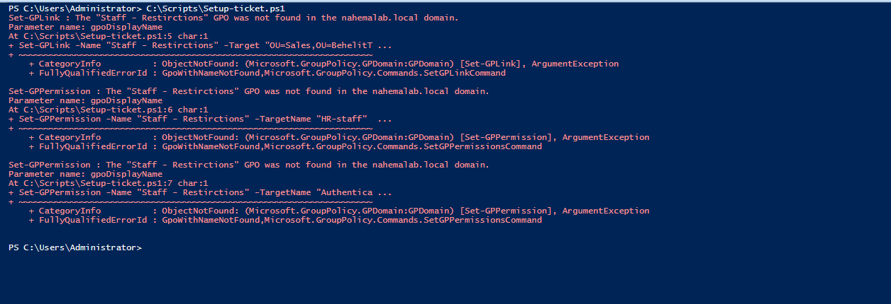

1) Walter in IT reported that Sales staff can get into Control Panel again, but HR still looks locked down. Logged in as Don Draper, I confirmed it: Control Panel opens.

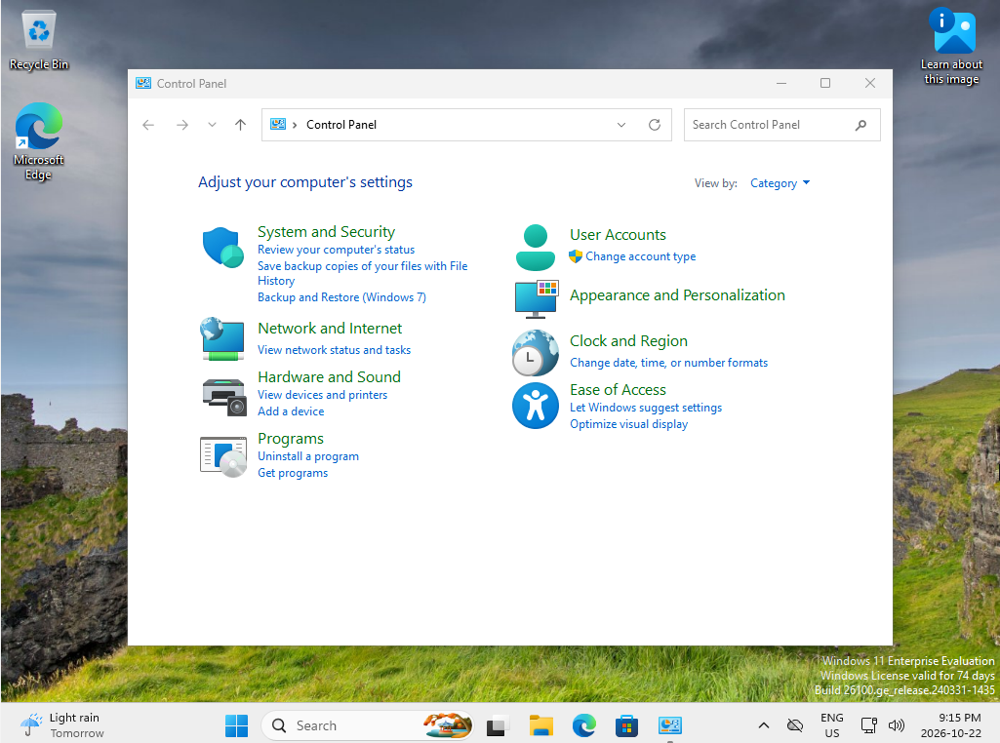

2) Instead of walking to Don's PC, I tried pulling a Group Policy Results report remotely from DC01. It failed with "The RPC server is unavailable," because the Windows Firewall on workstations blocks remote management by default.

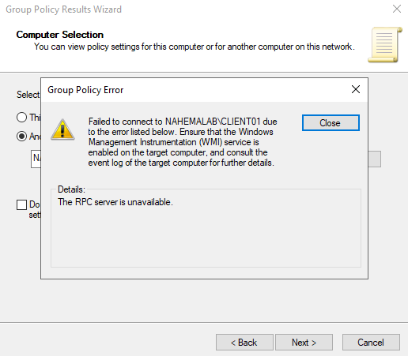

3) Rather than fixing that one PC by hand, I made a Workstations - Remote Management policy that allows Windows Management Instrumentation (WMI) through the firewall on every workstation. Now IT can pull reports from any company PC without bothering the user.

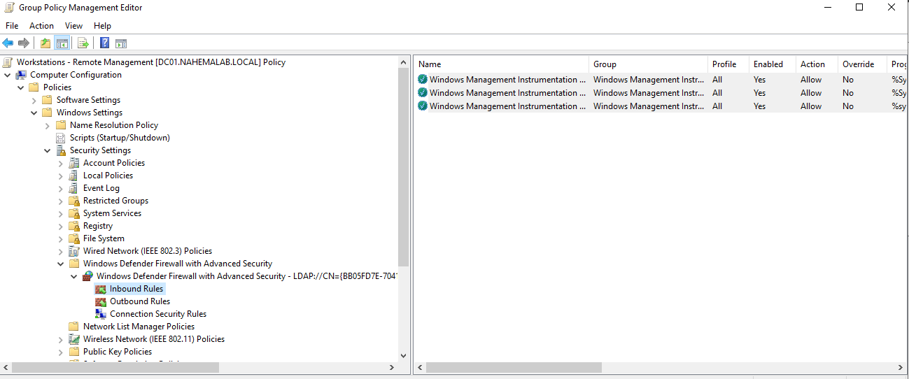

** WMI isn't remote control. It's like calling the PC's front desk and asking "which policies did you apply for Don?" Don doesn't see anything. Seeing his screen would be Remote Desktop or Quick Assist, which comes later.

4) The report worked (after allowing it past the server's Internet Explorer Enhanced Security). Staff - Restrictions was under Denied GPOs with the reason "Disabled Link" on the Sales OU.

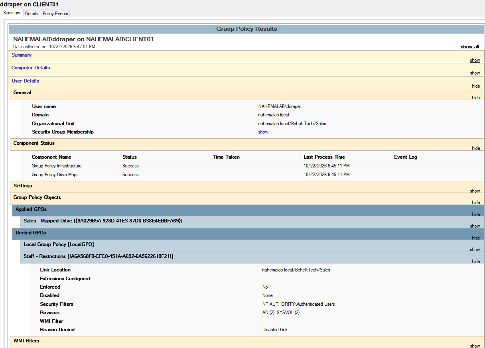

5) Sure enough, the link on the Sales OU was switched off. I re-enabled it.

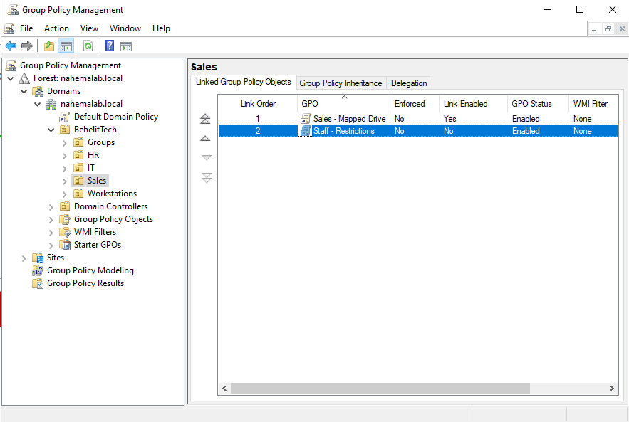

6) But Don could STILL open Control Panel. A fresh report showed the policy still denied, now for a different reason: "Access Denied (Security Filtering)," with the filter set to HR-staff only.

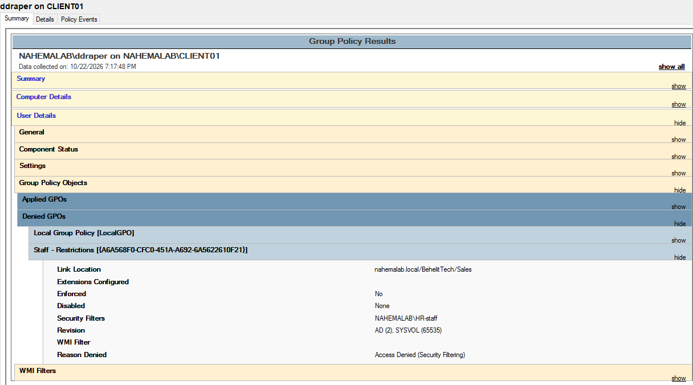

** A policy has two gates. The link decides WHERE it applies (which OUs). Security Filtering decides WHO in those OUs is allowed to receive it. Don passed the first gate once the link was back, but the second gate only let HR-staff through.

7) I had two options: add Sales-staff to the filter, or set it back to Authenticated Users (everyone who's logged in). I went with Authenticated Users. The OU links already decide who gets the policy, so managing it in two places just invites this exact ticket again. In a real job I'd also check whether someone narrowed it on purpose first.

8) After the fix, Don is blocked again, HR is still blocked, and IT still has access.

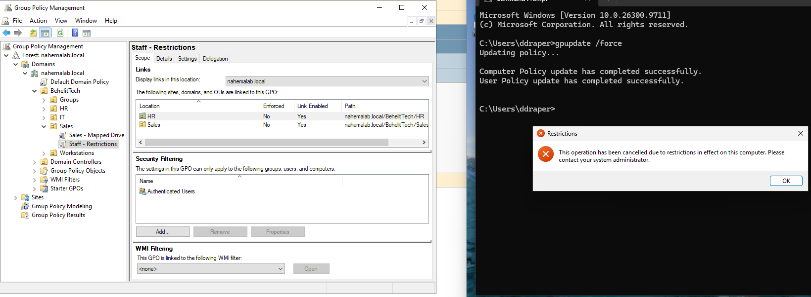

** Only after solving it did I read the setup script. It matched exactly: one line disabled the Sales link, and two lines changed the security filtering.

Root cause: two changes to Staff - Restrictions (Sales link disabled, security filtering narrowed to HR-staff). Prevention: audit Group Policy changes so we can see who changed what, which is what's next.

# Wrapping Up

Ticket #6 is the first one where I genuinely didn't know the answer, and it showed. Fixing the first cause and still seeing Control Panel open was frustrating, but that's what real troubleshooting looks like: you prove each cause with evidence and keep going until the problem is actually gone.

Biggest takeaways from Group Policy so far:
- OUs decide which policies you get, groups and security filtering decide whether they actually apply
- gpresult and Group Policy Results tell you not just what applied, but WHY something didn't
- Fixing the tooling (remote management) once saves walking to every PC forever

Next up: auditing, so changes like the ones in Ticket #6 leave a trail.

