# Part 13: Offboarding a Disgruntled Employee

## Dilemma: Jordan Belfort in Sales is being let go, and HR is worried he'll take it badly. He still has a working account and access to the Sales share, which holds client lists and commission rates. If he decides to delete or change files on his way out, the company needs to stop it, prove who did it, and get the data back.
## Objective: Set up the evidence and the backup first, then run a full offboarding: contain the account, investigate what he did, restore the damage, and remove every bit of access he had left.

Steps

** In practice, offboarding is coordinated with HR. The account is usually disabled during the termination meeting or a few minutes before it, so the employee never gets a window between hearing the news and losing access. In this lab, Jordan gets that window on purpose so there's something to investigate.

1) Before anything happens, the server needs to record file activity. Part 12 turned on auditing for logins and account changes, but file access is its own setting. In the DC - Audit Policy GPO, I set Object Access > Audit File System to Success and Failure.

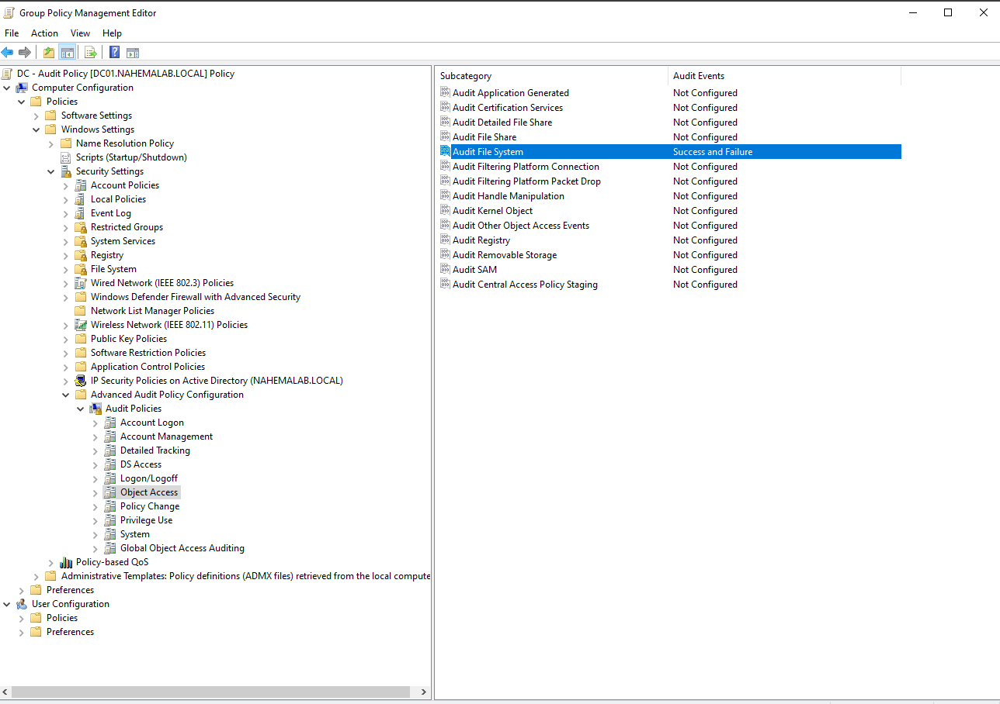

2) That setting alone logs nothing. File auditing needs a second switch on the folder itself, called a SACL, which says whose actions to record and which ones. On C:\Shares\Sales > Properties > Security > Advanced > Auditing, I added Sales-staff, Type All, and ticked only three boxes: Create files / write data, Delete subfolders and files, and Delete.

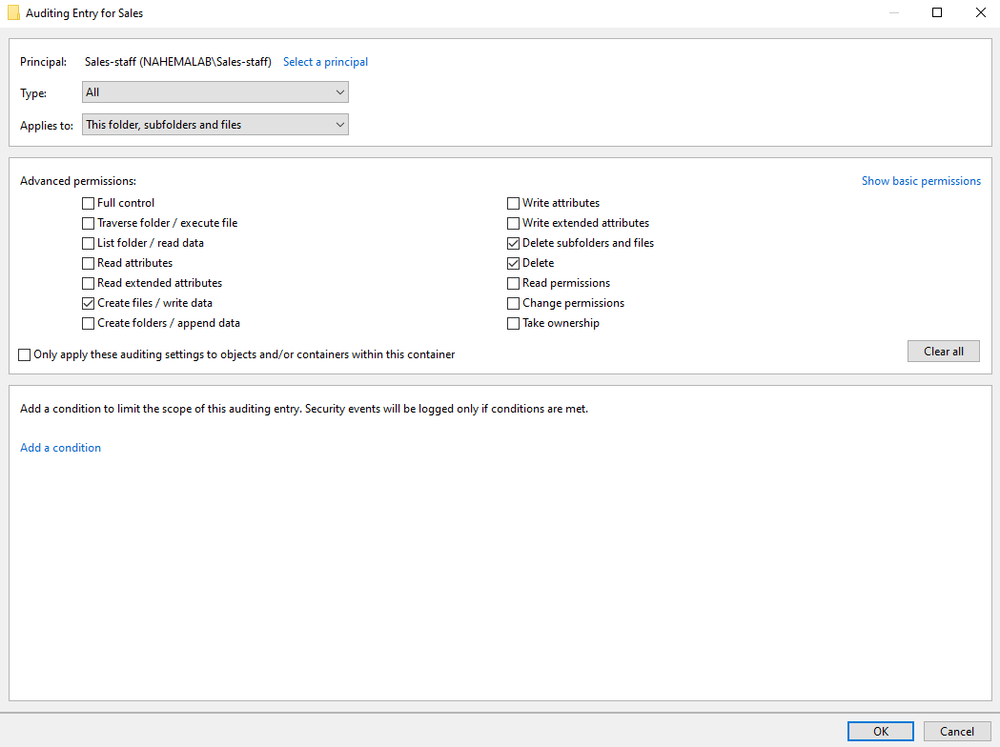

** File auditing is two switches: the policy (Audit File System) and the SACL on the folder. My first test logged nothing because the Auditing tab was empty. The policy was on, but no folder was being watched.

** I only ticked the three actions that matter here. Auditing "Full control" logs every file open and read, which floods the Security log and buries the events you actually need.

** The Permissions tab and the Auditing tab in Advanced Security look almost the same. On one attempt I edited the Permissions entry by mistake and gave Sales-staff Full control. Permissions decide what people can do, Auditing decides what gets written down. I set Sales-staff back to Modify before going further.

3) Next is the backup. Shadow Copies take point in time snapshots of a drive, and users and admins can restore files from them through the Previous Versions tab. On DC01, This PC > right click Local Disk (C:) > Configure Shadow Copies > Enable, then Create Now.

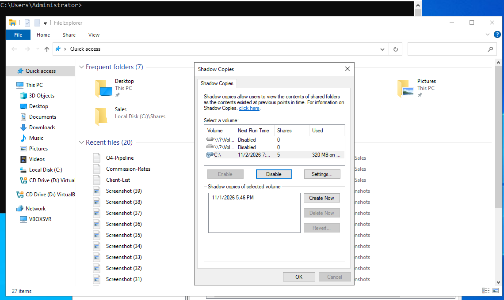

** A snapshot only protects what existed when it was taken. My first run of this scenario failed because I enabled Shadow Copies after the files were already damaged, so there was nothing to restore. I reset the files and redid it in the right order. Backups have to exist before the incident.

4) This is the Sales folder before Jordan touches it, with all three files in place.

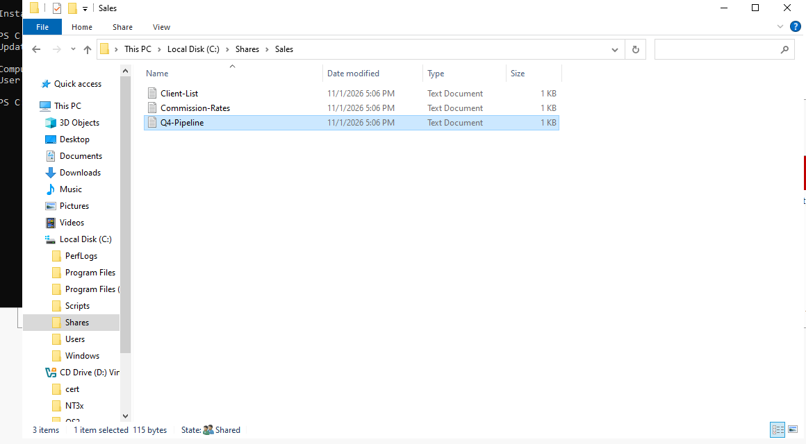

5) Now the incident. Logged into CLIENT01 as Jordan, I opened the Sales drive, deleted the client list, and rewrote Commission-Rates.txt.

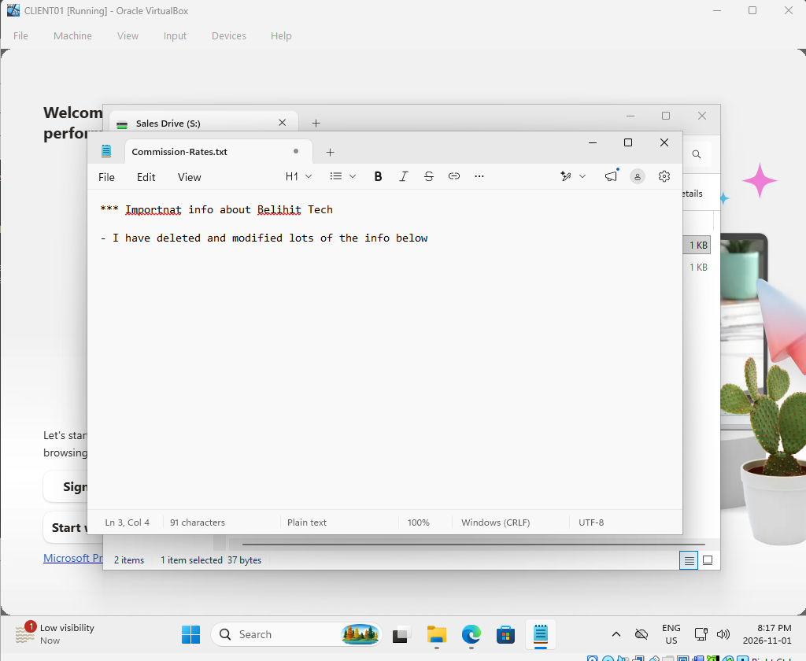

# Ticket #7: Terminated Employee Damaged Sales Files

## Dilemma: HR reports that Jordan Belfort was terminated today, and a Sales manager says a client list is missing and the commission rates look wrong. Jordan may still have access.
## Objective: Contain Jordan's account first, prove what happened from the logs, restore the files, and finish the offboarding.

P1-critical / tier-2 / access

1) Contain before investigating. The investigation can wait, but every minute Jordan keeps access is a chance to do more damage. On DC01, in PowerShell as admin:
   terminal> Disable-ADAccount jbelfort
   terminal> Get-ADUser jbelfort

Enabled now shows False.

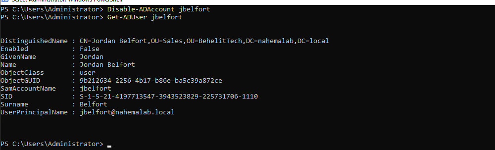

2) Then I checked that it actually stopped him. Jordan's session on CLIENT01 was still open, and he could unlock it and keep working. After a full sign out, a fresh login was refused.

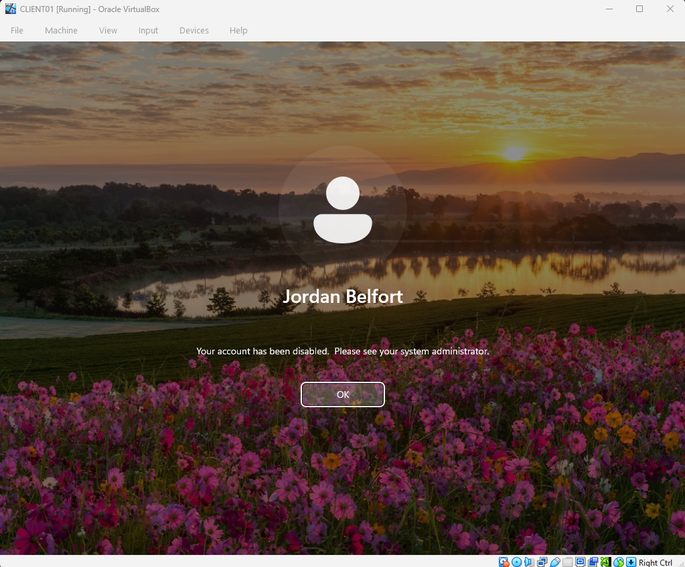

** Disabling an account blocks new logins, but it does not end a session that's already open. A locked screen can still be unlocked, and the session keeps its access to the Sales share. Laptops are worse: Windows caches the last login, so an offline laptop can still be signed into. Real containment means forcing a sign out (or pulling the device) as well as disabling the account.

3) With Jordan locked out, I went to the evidence. In Event Viewer > Security, Filter Current Log by 4659, 4663 and 4660 cut more than 22,000 events down to one: event 4659 at 7:07:44 PM.

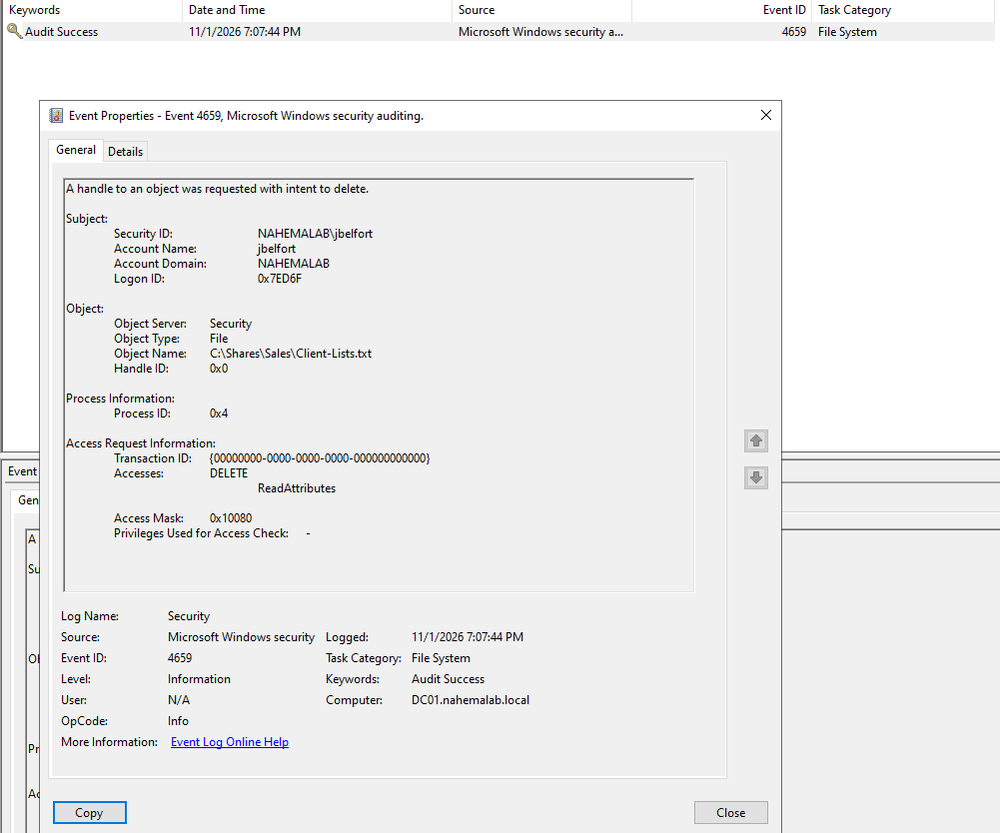

The event answers every question the ticket needs:
- Who: NAHEMALAB\jbelfort
- What: Accesses DELETE
- Where: C:\Shares\Sales\Client-Lists.txt
- When: 11/1/2026 7:07:44 PM

** I expected a 4663 (object access) or a 4660 (object deleted). Deletes made over a network share are often logged as 4659, "a handle to an object was requested with intent to delete," because the client opens the file with delete-on-close instead of a separate delete call. If the delete isn't where you expect it, widen the filter instead of assuming it wasn't logged.

** The Commission-Rates edit didn't show up as a 4663 WriteData event, even with the right SACL. Some editors save by writing a temp file and replacing the original, which doesn't always log as a plain write. Instead of relying on that log, I proved the edit by comparing the file against the Shadow Copy in the next step.

4) Time to restore. On DC01, C:\Shares\Sales > Properties > Previous Versions lists the snapshots. I picked the 6:50 PM one, from before the 7:07 PM delete.

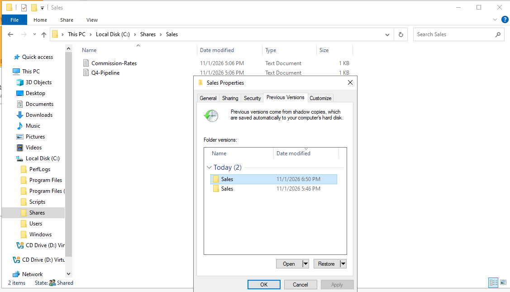

5) I used Open instead of Restore. Open shows the old copy next to the current folder, so I could compare them: the snapshot (left) still had the client list and the original commission rates, and the live folder (right) was missing the client list.

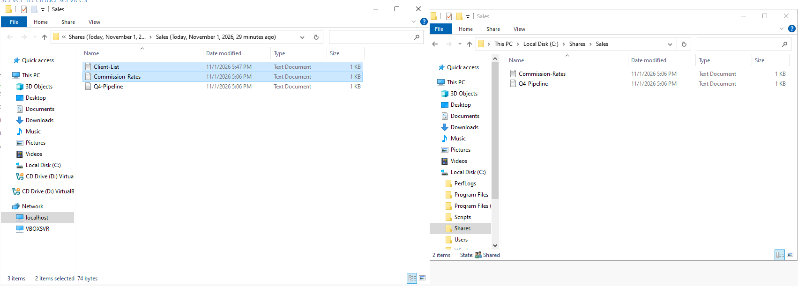

** Restore rolls the whole folder back to the snapshot, which would wipe out any legitimate work other Sales staff saved after 6:50 PM. Opening the snapshot and copying back only the damaged files fixes Jordan's changes without undoing anyone else's.

6) I copied the client list and Commission-Rates back into the live folder. All three files are back, with the original contents.

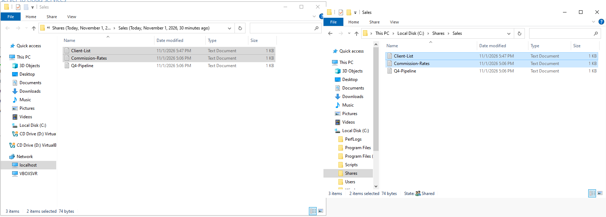

** Deletes made over a network share skip the Recycle Bin entirely, on both the user's PC and the server. Without Shadow Copies (or a real backup), this file would be gone.

7) A disabled account can still be re-enabled, by mistake or on purpose. So the last step is making the account useless even if that happens. First, I reset Jordan's password to a long random one that nobody records.

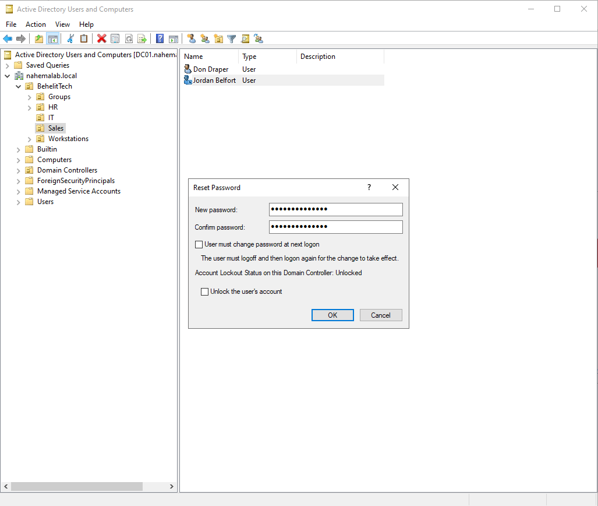

8) Then I removed him from Sales-staff, so he has no access to the share even if the account ever comes back. Domain Users stays, since Windows won't let you remove a user's primary group.

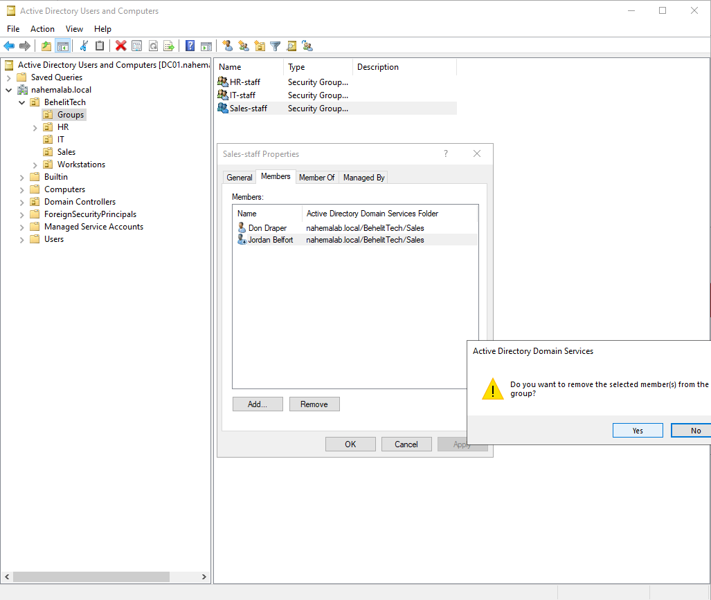

9) I added a description on the account: Disabled 2026-11-01 - Ticket #7 - terminated. The next admin who finds it knows why it's disabled and where to look, without digging.

<!-- TODO: add 17_jordan_description.png if a screenshot of the General tab is taken -->

10) Last, I created a Disabled Users OU under BehelitTech and moved Jordan into it. Disabled accounts stay separate from active ones, and he no longer picks up Sales policies like the mapped drive.

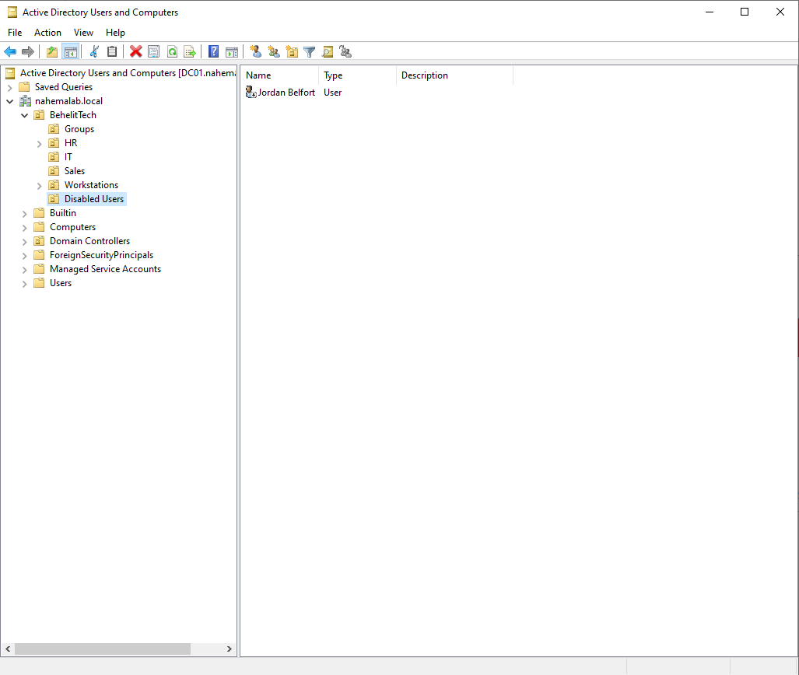

** The account isn't deleted yet. Companies usually keep disabled accounts for 30 to 90 days, because deleting one destroys its SID, group history and the link to the files it owned. If legal or HR needs anything from the account, it's still there.

# Wrapping Up

This ticket used almost everything from the earlier parts at once: auditing from Part 12 gave the evidence, groups from Part 5 decided what he could reach, OUs decided which policies he got, and PowerShell did the containment in seconds.

Biggest takeaways:
- Prepare before the incident. Auditing and Shadow Copies only help if they're already on.
- Contain first, investigate second. Disable the account and end the session, then look at logs.
- Disabling is not the end of offboarding. Reset the password, remove groups, document it, and move the account.
- Restore only what was damaged, not the whole folder.
- Logs need named accounts to mean anything. Jordan had his own account, so the 4659 points at one person.

Next up: turning these offboarding steps into a PowerShell script so every departure is handled the same way, with a log of what was done.

# References

- [Audit File System (Microsoft Learn)](https://learn.microsoft.com/en-us/windows/security/threat-protection/auditing/audit-file-system)
- [Event 4659: A handle to an object was requested with intent to delete (Microsoft Learn)](https://learn.microsoft.com/en-us/windows/security/threat-protection/auditing/event-4659)
- [Event 4663: An attempt was made to access an object (Microsoft Learn)](https://learn.microsoft.com/en-us/windows/security/threat-protection/auditing/event-4663)
- [Event 4660: An object was deleted (Microsoft Learn)](https://learn.microsoft.com/en-us/windows/security/threat-protection/auditing/event-4660)
- [Disable-ADAccount (Microsoft Learn)](https://learn.microsoft.com/en-us/powershell/module/activedirectory/disable-adaccount)
- [Volume Shadow Copy Service (Microsoft Learn)](https://learn.microsoft.com/en-us/windows-server/storage/file-server/volume-shadow-copy-service)
- [Windows Security Log Encyclopedia (Ultimate Windows Security)](https://www.ultimatewindowssecurity.com/securitylog/encyclopedia/)
