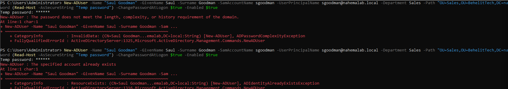
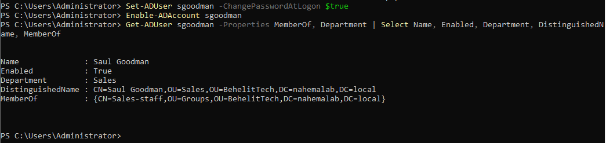
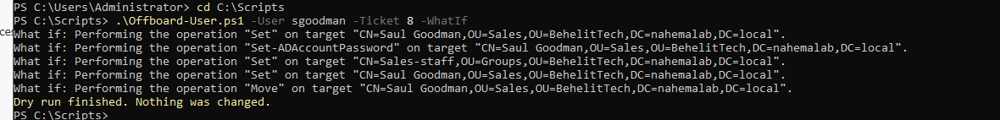
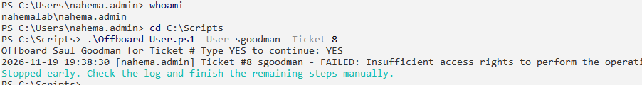
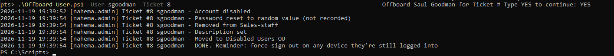
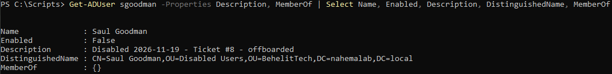
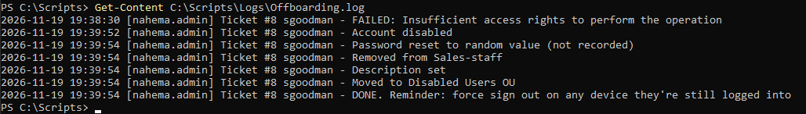

# Part 14: Automating Offboarding with PowerShell

## Dilemma: Jordan's offboarding in Ticket #7 took ten manual steps. It worked, but every one of them depended on me remembering it. Skip the group removal and the person keeps access to the share. Skip the description and the next admin has no idea why the account is disabled. A real help desk offboards people every week, and doing it from memory doesn't scale.
## Objective: Turn the Ticket #7 steps into one script that offboards anyone the same way every time, logs each action with who ran it and for which ticket, and can preview its changes before touching anything.

Steps

1) I needed someone to offboard, so I created a test user, Saul Goodman, in the Sales OU. This time I did it from PowerShell instead of ADUC, since New-ADUser is the same cmdlet a bulk onboarding script will use later. On DC01, in PowerShell as admin:
   terminal> New-ADUser -Name "Saul Goodman" -GivenName Saul -Surname Goodman -SamAccountName sgoodman -UserPrincipalName sgoodman@nahemalab.local -Department Sales -Path "OU=Sales,OU=BehelitTech,DC=nahemalab,DC=local" -AccountPassword (Read-Host -AsSecureString "Temp password") -ChangePasswordAtLogon $true -Enabled $true

The first try failed because my temp password was too short for the domain policy. Running the command again then failed with "The specified account already exists".

** A failed New-ADUser doesn't always roll back. AD created the account, couldn't set the password, and left it behind disabled with no valid password. Rerunning the same command won't fix it. You have to set a password on the existing account and enable it:
   terminal> Set-ADAccountPassword sgoodman -Reset -NewPassword (Read-Host -AsSecureString "Temp password")
   terminal> Set-ADUser sgoodman -ChangePasswordAtLogon $true
   terminal> Enable-ADAccount sgoodman

2) Then I added Saul to Sales-staff so he has real access for the script to remove, and checked the result.
   terminal> Add-ADGroupMember -Identity Sales-staff -Members sgoodman
   terminal> Get-ADUser sgoodman -Properties MemberOf, Department | Select Name, Enabled, Department, DistinguishedName, MemberOf

3) Next I wrote [Offboard-User.ps1](../scripts/Offboard-User.ps1), saved on DC01 as C:\Scripts\Offboard-User.ps1. It takes a username and a ticket number, and does the same five things I did by hand for Jordan:
- Disable the account
- Reset the password to a random 24 character value that is never written down
- Remove every group, logging each name
- Set the description to "Disabled date - Ticket #n - offboarded"
- Move the account to the Disabled Users OU

Before any of that, it checks that the user exists and asks me to type YES with the person's full name on screen. Offboarding the wrong person is a lot harder to undo than typing three letters.

4) Every action goes to C:\Scripts\Logs\Offboarding.log with a timestamp, the admin who ran it and the ticket number. The group names are in the log on purpose: if HR reverses the decision, the log says exactly which access to give back.

** The first draft logged each step right after running it, without checking whether it worked. If Disable-ADAccount had failed, the log would still say "Account disabled". Setting $ErrorActionPreference to Stop and wrapping the steps in try/catch means any failure stops the script and logs FAILED with the real error. An audit log is only worth something if it can't claim things that didn't happen.

5) I also added a -WhatIf dry run. One line at the top, [CmdletBinding(SupportsShouldProcess)], and every AD cmdlet inside the script respects -WhatIf without any extra code. The script writes nothing to the log during a dry run, since nothing actually happened.

6) Last piece of prep: the account running the script. Part 12 showed that every change in my logs came from the shared Administrator account, so they proved which account did something, not which person. That would make the script's [admin] field useless. I created a personal admin account and added it to Domain Admins:
   terminal> New-ADUser -Name "Nahema Admin" -SamAccountName nahema.admin -UserPrincipalName nahema.admin@nahemalab.local -Path "OU=IT,OU=BehelitTech,DC=nahemalab,DC=local" -AccountPassword (Read-Host -AsSecureString "Password") -Enabled $true
   terminal> Add-ADGroupMember -Identity "Domain Admins" -Members nahema.admin

My regular account, ngutema, stays a normal user for daily work. Admin rights live only on nahema.admin, so a phished daily account doesn't hand over the domain. The built-in Administrator is now kept for emergencies only.

# Ticket #8: Offboard Saul Goodman

## Dilemma: Jon Snow in HR reports that Saul Goodman resigned and today is his last day. His access needs to end at close of business, and his manager wants a record of what he had access to.
## Objective: Offboard Saul with the script, prove every change independently, and hand the manager the access record.

P3-medium / tier-1 / access

1) A planned resignation isn't an emergency like Jordan, so there was time to do it carefully. I started with a dry run, signed in as nahema.admin:
   terminal> cd C:\Scripts
   terminal> .\Offboard-User.ps1 -User sgoodman -Ticket 8 -WhatIf

Five "What if" lines, one per step. The group removal shows up as a change to Sales-staff, not to Saul, because membership is stored on the group.

2) The first real run failed on step 1 with "Insufficient access rights". The script stopped right there and logged the failure, so Saul was untouched and nothing was half done.

** nahema.admin is a Domain Admin, but the window title said "Windows PowerShell", not "Administrator: Windows PowerShell". User Account Control gives admin accounts a standard token until you choose Run as administrator. Being in the right group isn't enough, the process has to be elevated too.

3) In an elevated window, the real run went through. Each step logged in about two seconds, all stamped with nahema.admin and Ticket #8.
   terminal> .\Offboard-User.ps1 -User sgoodman -Ticket 8

The confirmation prompt shows "Ticket #" with no number. PowerShell read "$Ticket?" as one variable name, since ? is a legal character in variable names. Writing it as $($Ticket)? fixed it, and the version in this repo has the fix.

4) I didn't take the script's word for it. A separate query checked the account directly:
   terminal> Get-ADUser sgoodman -Properties Description, MemberOf | Select Name, Enabled, Description, DistinguishedName, MemberOf

Disabled, described, in Disabled Users, and MemberOf is empty.

** The script prints success messages, but those come from the same code that could be wrong. Checking with a separate command is what actually proves the change. This is the same habit as running gpresult instead of trusting that a GPO applied.

5) The log file is the record for HR and Saul's manager. It keeps the failed attempt from step 2 right above the successful run, so the full history is there.
   terminal> Get-Content C:\Scripts\Logs\Offboarding.log

6) Finally, I tested the most likely real mistake, a typo in the username:
   terminal> .\Offboard-User.ps1 -User fakeuser -Ticket 8

It stopped before the YES prompt and changed nothing.

Root cause: none, this was a planned departure. Process note: offboarding now runs from one script with a dry run, a confirmation and a log, instead of a manual checklist.

# Wrapping Up

Ticket #7 taught the steps. This part turned them into something that runs the same way every time, and most of the work went into making it safe rather than making it work.

Biggest takeaways:
- Automate a process only after doing it by hand, so you know what each step is for.
- A dry run, a confirmation and an existence check are cheap and stop the expensive mistakes.
- Logs must record failures honestly, and they need a named account to point at.
- Domain Admin rights still need an elevated window because of UAC.
- Verify the result with a separate command instead of trusting the script's own output.

The script was written with AI help. The steps it automates came from Ticket #7, and the testing above (the dry run, the failed run, the verification and the typo test) was done by hand in the lab.

Next up: onboarding, with a script that creates users in bulk from a CSV, and a help desk account that can only unlock accounts and reset passwords.

# References

- [New-ADUser (Microsoft Learn)](https://learn.microsoft.com/en-us/powershell/module/activedirectory/new-aduser)
- [Remove-ADGroupMember (Microsoft Learn)](https://learn.microsoft.com/en-us/powershell/module/activedirectory/remove-adgroupmember)
- [Move-ADObject (Microsoft Learn)](https://learn.microsoft.com/en-us/powershell/module/activedirectory/move-adobject)
- [about_Functions_CmdletBindingAttribute (Microsoft Learn)](https://learn.microsoft.com/en-us/powershell/module/microsoft.powershell.core/about/about_functions_cmdletbindingattribute)
- [about_Preference_Variables: $ErrorActionPreference (Microsoft Learn)](https://learn.microsoft.com/en-us/powershell/module/microsoft.powershell.core/about/about_preference_variables)
- [How User Account Control works (Microsoft Learn)](https://learn.microsoft.com/en-us/windows/security/application-security/application-control/user-account-control/how-it-works)
- [Securing built-in Administrator accounts in Active Directory (Microsoft Learn)](https://learn.microsoft.com/en-us/windows-server/identity/ad-ds/plan/security-best-practices/appendix-d--securing-built-in-administrator-accounts-in-active-directory)
- [Membership.GeneratePassword (Microsoft Learn)](https://learn.microsoft.com/en-us/dotnet/api/system.web.security.membership.generatepassword)
